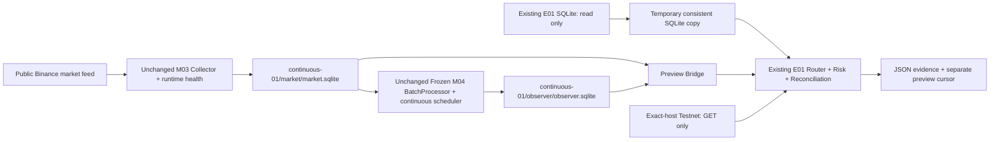

# DEV-M05 — continuous NUC runtime and observation-only Testnet bridge

Status: **DEV-M05_HOLD** pending NUC TEST-02–07. Development/mock evidence is
not deployment or live acceptance. No activation/submission command is implemented
in this runtime. T1 remains W03_PASS_WITH_FLAGS / Paper Candidate; T2/T3 remain
W03_HOLD / SHADOW_SIGNAL_ONLY. W04 clocks, data, ledgers and Frozen rules are unchanged.

## Audited baseline

Remote `dev-m04-strategy-observer` and local development base:
`8c6bea8483437bd083a2793c70e4c8b49de197f9`. Git ancestry confirms E01
`72a63e9329f0702fd90805f30cb342b0b6725fa0` is included. GitHub PR #7 is merged
into that M04 branch at the base SHA. `main` remains `59df61d` at initial audit.
The new branch is `dev-m05-nuc-runtime-testnet-bridge`; no existing branch is rewritten.
`DEV-M05-source-manifest.json` protects all 71 existing source files and the E01
freeze manifest (72 files total). The original E01 61-file freeze test remains unchanged.

The NUC connector returned `gomi-mini`, isolated-development-only scope,
`deployment_enabled=false`, `network_enabled=false`, and production paths blocked.
The existing 24H counters and manual Testnet fill in the request are **user-provided
prior evidence**, not new M05 observations. No NUC credentials or operational DB
contents were accessed. NUC Ubuntu/Python versions still require host preflight.

## Responsibility and data flow

| Component | Writer and account | Other access |
| --- | --- | --- |
| Market DB, WAL, lock, collector health | M03 / `crypto-collector` | Observer/Bridge read only |
| Observer DB, WAL, lock, observer health | M04 / `crypto-observer` | Bridge read only |
| Existing Testnet journal | existing E01 engine/account only | M05 Bridge read only |
| Temporary E01 copy | Preview Bridge only | deleted after each cycle |
| Preview JSON cursor/evidence/health | `crypto-bridge` | operator read only |

Candidate flat DB paths were adjusted to separate role directories so filesystem
permissions can enforce one writer including SQLite WAL/SHM sidecars. All three
physical DBs differ. Original `close-validation-01`, `dev-m04`, `dev-e01`, and the
E01 execution journal are never initialized, merged, truncated, restored or migrated
by M05. Hardlink/symlink collisions and protected validation paths are rejected.

## Duration analysis and continuous collection

M03 `Collector.run()` and `WebSocketMonitor.run()` both reject non-finite/non-positive
durations. The existing CLI defaults to 600 seconds; `--duration 86400` ends the
entire run. M04 CLI similarly ends its polling loop and marks the run STOPPED.
Repeating either command daily would create observation-session boundaries and
could reclassify/delay/miss the close at restart.

The runtime bypasses the *finite CLI session* through a thin operational adapter:
it calls the unchanged Collector once with `sys.float_info.max`, the largest finite
float, and an explicit stop event. This is a finite numeric sentinel, **not literal
infinity**, but has no reachable 24H/daily/annual deadline. It requires no monkeypatch,
clock manipulation, copied collector, or daily process rotation. Unexpected return
is an operational failure; it is not silently treated as a completed daily job.
SIGTERM/SIGINT sets the stop event, drains/commits the original bounded queue and
runs the original final REST recovery. A caller tracks requested stop separately
because M03 sets its stop event internally on all exits. `--smoke-seconds` is the
only deliberately bounded runtime mode.

Binance socket lifetime is still bounded: the original monitor reconnects before
24H, retains queue/state, and invokes M03 REST corroboration/recovery after each
connection generation. Existing conflict detection and ACK-after-commit stay intact.
A virtual-clock test spans 25H in one ingestion run and observes socket rotation;
this is not a real 25H smoke test.

A new market DB needs all bars from Frozen `FREEZE_MS` (2026-10-02 12:00 UTC), not
just the old seven-day default. Initial bootstrap computes the necessary days plus
margin within M03's 365-day limit. Existing DB restarts use normal seven-day recovery
and preserved history. A new empty installation outside the supported bootstrap
range is HOLD. Incomplete recovery/conflicts/stale feeds withhold READY health.
Market price snapshots use 10 seconds to satisfy E01's unchanged 30-second reference
freshness limit. Candle rules, evaluation timing, sizing and prices are unchanged.

## Observer scheduling and restart

The runtime acquires the original OS WriterLease and starts the original ObserverStore
and BatchProcessor. It resumes at the nine consistent committed checkpoints + 4H;
a new DB begins at the first forward Frozen boundary. It processes every pending
bar in order, one complete three-symbol/nine-decision batch at a time. It never
jumps directly to the latest bar after downtime. Failed/incomplete batches do not
advance checkpoints. Catch-up health remains DATA_HOLD until the backlog is complete.

Each new process records a new run/live floor. Missing-data or collector-health
holds advance and persist that floor. Old WS bars and REST_RECOVERY bars remain
PRELAUNCH_STATE_BACKFILL; they cannot become live candidates retrospectively.
Committed original decisions retain their hashes and ownership of the original run.
E01 additionally requires a batch belonging to the active OBSERVING run. Frozen
source/rule and persistent SQLite integrity failures exit 78 for operator review.
No source, manifest, W03 registry or formal W04 start is edited.

## Preview semantics and safety

E01's existing `route(dry_run=True)` writes receipts, checkpoint and Phase A evidence.
Running it against the real order journal would consume signals. M05 instead opens
the real E01 journal with SQLite `mode=ro` + `query_only`, integrity-checks it, and
uses SQLite Backup API to a temporary dedicated-name DB. Only that expendable copy
is opened by ExecutionStore/OrderManager. Online reconciliation also writes only
to the copy. The real database schema, session binding, gates, receipt/checkpoint,
manual history and allocations are untouched.

The separate durable preview cursor excludes all rows present at its first startup.
It binds input paths, activation time, first/last decision hashes and rowid; restart
uses the saved cursor, not a new watermark. Corrupt/replaced/truncated sources or
backward clocks stop safely. Old records after downtime are reported as stale or
non-live by E01, never promoted. Preview evidence is fsynced before cursor advancement;
a crash between them may repeat an **observation report**, but cannot duplicate an
order or mutate an execution receipt. Actual future activation must initialize the
real E01 router separately and requires a different fresh, approved signal.

For every new row, evidence includes decision type, provenance/hash validation and
T1/T2/T3 policy, including NO_ACTION. Router and Risk are reused with their original
60s signal, 5s quote, 30s reference limits; actual capital/position ownership,
kill/hold/unknown and reconciliation are not inferred from account funds. No T1
allocation is created. Offline `--assumed-capital` uses an expendable assumed-flat
manager and labels the result SIMULATED_TEST; it is forbidden online. An offline
copy may rebind only its temporary fingerprint so keys are not needed; account
identity is explicitly NOT_VERIFIED_OFFLINE.

Bridge checks fresh READY health before and after evaluation and detects dependency
process replacement during the cycle. It refuses both unlock variables unless OFF.
The read-only E01 client denies all non-GET calls at both API and HTTP send boundaries.
Only the existing exact `https://testnet.binance.vision` allowlist/signing/TLS rules
and fixed Testnet public WS quote provider are used; there is no production order
adapter. Public production market data is still the M03 signal source. No actual
POST (including order/test), DELETE, submit, cancel, allocate or automation activation
is available in the runtime CLI or systemd units.

Unattributed local exchange orders are reported as MANUAL_BASELINE, never retroactively
T1. At a separately approved future allocation, E01's original MANUAL approval/fill
attribution gates must pass; legacy journal compatibility is not assumed. Unknown
execution, reset/balance discrepancies or persistent E01 holds are review blockers.
Preview cannot repair or clear those holds in the real journal.

## Services and failures

Collector starts after network-online; Observer Wants/After Collector; Bridge
Wants/After both. `After` means process startup ordering, not data readiness: JSON
health and M04's three-symbol/input gates enforce readiness. `Wants` lets consumers
stay in HOLD and resume after a producer restart without systemd stopping them
permanently. Dependency restart uncertainty invalidates the current preview cycle.

Each role has an OS service lease before any shared health/log write; original
M03/M04 DB leases add protection against other legacy writers. Locks release on
process death, not by deleting lock files. Three unprivileged accounts have no sudo
or capabilities. systemd ProtectSystem/ReadWritePaths isolates writers; Observer
has only AF_UNIX. Collector/Observer have no EnvironmentFile. Bridge alone receives
the dedicated Testnet environment, and runtime rejects an enabled unlock even if
EnvironmentFile overrides unit defaults. Production key variables are unset.

Restart=on-failure, 30s delay, three starts/600s, permanent config/source/ownership
exit 78 prevents restart. Requested stop/normal bounded smoke exits do not restart.
Transient network/rate errors remain HOLD with bounded 5–60s backoff; collection
uses original bounded recovery/reconnect logic. Heartbeats are freshness/boot bound,
not proof that a hung process has exited. A hung owner still holds its lease;
consumers stop routing when health exceeds 30s. systemd owns the process group and
allows 120s graceful shutdown, then SIGKILL; the next start reconciles committed DB
state and conservatively reclassifies recovered bars. No pending order is replayed.

Journald receives stdout and fixed error categories. Each role also keeps atomic
health.json, rotating runtime.jsonl (10 MB x 6), and Bridge keeps latest-preview.json.
Observer uses WAL/FULL/busy_timeout/autocheckpoint 1000 and a passive shutdown
checkpoint; M03/E01 WAL/FULL policies are reused. Read-only consumers never issue
checkpoints. Read-only Backup API includes committed WAL state. Never remove WAL/SHM,
copy a live sqlite file with cp, or delete the journal to clear a hold.

## Operational risk before ending DRY_RUN

Existing LIMIT/GTC orders can remain at the exchange during server/Bridge downtime.
A filled Testnet position's software ATR stop needs a running reconciled server,
fresh feed and available order budget; it is **not an exchange-held protective stop**.
Network, restart, server power loss, kill switch, risk caps or minimum filters can
prevent/delay the exit. Systemd does not eliminate this risk. No automatic service
activation is prepared as a hidden fallback. TEST-08 must separately review this risk,
manual baseline attribution, T1 capital, all gates and an approved execution scheduler;
TEST-09 needs separate approval of one new real T1 signal and exact small order.
Until then execution remains OFF and final live acceptance remains HOLD.

Reconciliation/reset/account/source-integrity failures also latch a separate
`bridge/preview-hold.json` with the original category. It survives process and
server restart and has no automatic clear option. Network/quote/rate and producer
readiness holds may retry with backoff; they still route no orders. An operator must
review evidence before archiving a preview hold. This never changes/clears an actual
E01 hold or authorizes activation. Read-only reconciliation holds are not discarded
merely because a temporary journal copy is removed.
